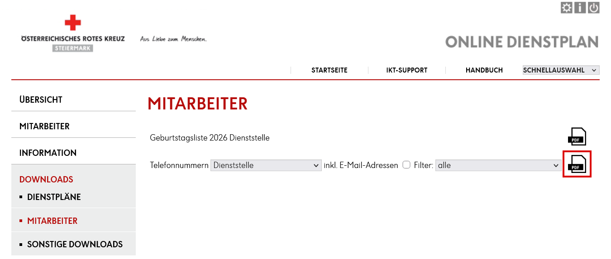
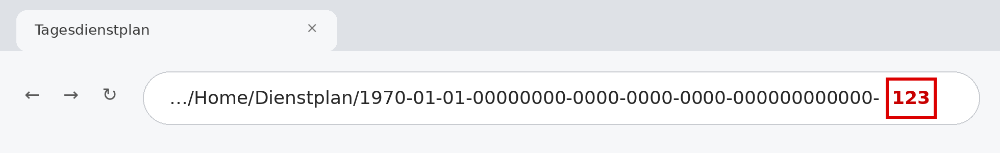

# RKTel

**RKTel** ist ein Telefonbuch fürs Handy, gemacht für den Dienst beim Roten Kreuz Steiermark. Es knüpft an die Services an, die du ohnehin nutzt – den **Online Dienstplan** mit seiner Telefonliste und deinem persönlichen Dienstplan-Kalender – und macht daraus eine schnelle App: Kontakte suchen, anrufen oder per WhatsApp schreiben, und auf Wunsch sehen, mit wem du deinen nächsten Dienst hast.

RKTel läuft als Web-App (PWA) im Browser und lässt sich auf iPhone und Android wie eine normale App auf den Home-Bildschirm legen – ohne App Store.

> **Privates Eigenprojekt.** RKTel ist kein Angebot des Österreichischen Roten Kreuzes und wird von diesem weder entwickelt, betrieben, geprüft noch unterstützt. Es besteht keine Verbindung zum Online Dienstplan oder dessen Betreibern; RKTel verarbeitet lediglich Exporte (PDF, Kalender), auf die du selbst Zugriff hast. Genannte Namen und Marken gehören ihren jeweiligen Inhabern. Bei Fragen zu RKTel bitte nicht an Stellen des Roten Kreuzes wenden, sondern an den [Kontakt](#kontakt) unten.

**Der Weg durch diese Anleitung**

1. [App installieren](#1-app-installieren)
2. [Telefonbuch befüllen](#2-telefonbuch-befüllen) – Telefonliste aus dem Online Dienstplan importieren
3. [Im Alltag](#3-im-alltag) – suchen, anrufen, Favoriten
4. [Optional: Dienstplan verbinden](#4-optional-dienstplan-verbinden) – nächste Dienste samt Kollegen
5. [Daten & Sicherheit](#5-daten--sicherheit)

---

## 1. App installieren

- **iPhone (Safari):** RKTel öffnen → Teilen-Symbol → „Zum Home-Bildschirm“.
- **Android (Chrome):** RKTel öffnen → Menü ⋮ → „App installieren“ bzw. „Zum Startbildschirm hinzufügen“. Bietet Chrome die Installation an, erscheint unter *Einstellungen → Über* auch der Button „Als App installieren“.

Nach dem ersten Öffnen funktioniert das Telefonbuch auch ohne Internet.

## 2. Telefonbuch befüllen

Die Kontakte kommen aus der Telefonliste des Online Dienstplans.

1. Im **Online Dienstplan** anmelden.
2. Links **Downloads → Mitarbeiter** öffnen.
3. In der Zeile **Telefonnummern** die Liste wählen (z. B. *Dienststelle*) und den Filter (z. B. *alle*). „inkl. E-Mail-Adressen“ ist nicht nötig.
4. Auf das **PDF-Symbol rechts in der Zeile „Telefonnummern“** tippen (rot markiert) – *nicht* auf das Symbol der Geburtstagsliste darüber.
5. PDF speichern (iPhone: Teilen → „In Dateien sichern“; Android: Download-Ordner).
6. In RKTel unter **Einstellungen → Telefonbuch** das PDF auswählen.



*Screenshot des Online Dienstplans (Logo entfernt), nur zur Orientierung.*

Für weitere Dienststellen einfach wiederholen: Kontakte werden anhand des Namens zusammengeführt, Telefonnummern ergänzt. Erkannt werden außerdem Dienststelle und Erstellungsdatum der Liste (in den Kontaktdetails sichtbar). E-Mail-Adressen und Qualifikationszusätze in Klammern, z. B. „(RS, SEF)“, werden verworfen. Die Verarbeitung passiert vollständig auf dem Gerät – das PDF wird nirgends hochgeladen.

Kommt die Meldung „Keine Kontakte erkannt“, stammt das PDF nicht aus diesem Export.

## 3. Im Alltag

- **Suchen** nach Name, Nummer oder Dienststelle; 📞 ruft an, 💬 öffnet WhatsApp.
- **Favoriten:** Kontakt öffnen → Bearbeiten → „Anpinnen“. Angepinnte Kontakte stehen als Kacheln ganz oben.
- **Kontakte** lassen sich auch von Hand anlegen, bearbeiten und löschen; *Einstellungen → Daten* exportiert alles als JSON-Sicherung.
- *Nebenbei:* Wer Einsatzmittel häufig über eine gemeinsame Vorwahl anruft, kann unter *Einstellungen → Kurzwahl* eine Basisnummer hinterlegen. Dann erscheint neben den Favoriten eine Kachel „Einsatzmittel“, in die nur noch die Endnummer getippt wird (z. B. Basisnummer + 1825).

## 4. Optional: Dienstplan verbinden

Wer nur das Telefonbuch nutzt, kann hier aufhören. Ohne verbundenen Kalender ist der Dienstplan in der App komplett ausgeblendet.

### Was du bekommst

Ein Tab **„Dienste“** mit deinen kommenden Diensten aus dem Online Dienstplan: Datum, Zeit, Fahrzeug/Titel, Ort und die **eingeteilten Kollegen** – direkt mit 📞- und 💬-Button, sofern sie im Telefonbuch stehen. Die Kollegen werden unabhängig von Namensreihenfolge, Groß-/Kleinschreibung, Umlautschreibweise (ä/ae) und Titeln (Mag., Ing., …) gefunden. Ist der Dienstplan verbunden, startet die App direkt in diesem Tab.

Optional öffnet ein Button **„Dienstplan ↗“** in jeder Dienstkarte den Tag im Online Dienstplan (siehe [Dienststellen](#dienststellen--links-ins-online-dienstplan)).

### Warum ein Cloudflare Worker?

Der Online Dienstplan stellt deinen Dienstplan als privaten Kalenderlink (`…/Calendar/…/Private.ics`) bereit. Browser dürfen diesen aber nicht direkt aus einer Web-App abrufen, weil der Server keine Freigabe dafür sendet (CORS). Das gilt für **alle** Browser gleichermaßen – Safari, Chrome, Firefox, Samsung Internet, auf iPhone wie auf Android –, da die Regel vom Server vorgegeben und von jedem Browser durchgesetzt wird. Ein kleiner, kostenloser **Cloudflare Worker** holt den Kalender daher serverseitig und gibt ihn nur an dich weiter.

So bleibt dein Kalender geschützt:

- Der private Kalenderlink liegt **nur** als verschlüsseltes Secret `ICS_URL` im Worker – nicht im Code, nicht im Repository, nicht in der App.
- Der Worker ruft ausschließlich diese eine Adresse ab (kein offener Proxy).
- Zugriff nur mit deinem zufälligen **Zugangsschlüssel** (Secret `ACCESS_TOKEN`, mind. 32 Zeichen), den du selbst in der App einträgst. Die Herkunftsprüfung (`ALLOWED_ORIGINS`) kommt nur zusätzlich dazu.
- Der Worker loggt nichts; Fehlermeldungen enthalten weder Link noch Schlüssel.

> Warum kein Cloudflare-Login (Access)? Der arbeitet mit Cookies, die Safari bei Abrufen aus einer anderen Domain blockiert – in der Home-Bildschirm-App wäre das unzuverlässig. Ein langer Zufallsschlüssel ist hier die robustere Wahl. Den Schalter „Protect with Cloudflare Access“ daher **aus** lassen.

### Einrichtung Schritt für Schritt

Alles geht im Browser, auch am Handy; keine eigene Domain nötig.

1. **Konto:** kostenlos auf [dash.cloudflare.com](https://dash.cloudflare.com) anlegen. Beim ersten Worker wird eine Adresse `<name>.workers.dev` vergeben.
2. **Worker anlegen:** *Workers & Pages → Erstellen → Worker → „Hello World“*, Name `rktel-dienstplan` → *Bereitstellen*.
3. **Code einfügen:** *Edit code* → den Inhalt von [`worker/src/index.js`](worker/src/index.js) vollständig einfügen → *Deploy*.
4. **Zugangsschlüssel erzeugen:** in RKTel unter *Einstellungen → Dienstplan → „Neuen Schlüssel erzeugen“* (wird kopiert).
5. **Variablen und Secrets** (*Settings → Variables and Secrets → Add*):
   - `ICS_URL` – Typ **Secret** – dein privater Kalenderlink aus dem Online Dienstplan
   - `ACCESS_TOKEN` – Typ **Secret** – der Schlüssel aus Schritt 4
   - `ALLOWED_ORIGINS` – Text – Adresse der App, z. B. `https://vitushg.github.io`
   - `UPSTREAM_HOST` – Text – der Servername aus deinem Kalenderlink (der Teil zwischen `https://` und dem ersten `/`)
6. **Logs aus:** *Settings → Observability* → Workers Logs deaktivieren. Unter *Domains & Routes* `workers.dev` aktiv lassen, Preview URLs deaktivieren.
7. **In RKTel verbinden:** *Einstellungen → Dienstplan* → Worker-Adresse (`https://rktel-dienstplan.<name>.workers.dev`) und Schlüssel eintragen → *Speichern & laden*.
8. **Prüfen:** `https://rktel-dienstplan.<name>.workers.dev/dienstplan.ics` im Browser muss `{"error":"unauthorized"}` zeigen.

Per Kommandozeile geht es alternativ im Ordner `worker/` mit `npx wrangler secret put ICS_URL`, `npx wrangler secret put ACCESS_TOKEN` und `npx wrangler deploy` (Konfiguration in `worker/wrangler.toml`).

**Schlüssel wechseln:** neuen Schlüssel erzeugen → Secret `ACCESS_TOKEN` im Worker ersetzen → in der App eintragen. Der alte ist sofort ungültig.

### Aktualisieren

Der Dienstplan wird geladen, wenn du die App öffnest oder wieder in den Vordergrund holst (höchstens alle 5 Minuten), mit **„Aktualisieren“** oder indem du auf der Dienste-Seite **von oben nach unten ziehst**. Ohne Verbindung bleibt der zuletzt geladene Stand mit Hinweis sichtbar. Es gibt keine Hintergrundabfragen und keine Benachrichtigungen.

### Dienststellen & Links ins Online Dienstplan

Damit „Dienstplan ↗“ erscheint, braucht RKTel die **ID** der Dienststelle. Eintragen unter *Einstellungen → Dienstplan → Dienststellen → „+ Dienststelle hinzufügen“*: Name, ID und optional Ausnahmeregeln.

**Woher kommt die ID?** Im Online Dienstplan auf der **Startseite** in den **Tagesdienstplan** der Dienststelle klicken und auf die Adresszeile schauen – die Zahl ganz am Ende ist die ID:



**Zuordnung von Ort zu Dienststelle:**

- Der Ort eines Dienstes wird mit dem Dienststellennamen verglichen; „RKZ“ und „West“ werden ignoriert („MINA RKZ“ → „MINA“), ebenso Groß-/Kleinschreibung und Akzente. Bei langen Namen wie „1 RKHE 05 - Sanitätshilfsstelle (SanHiSt)“ passen auch „Sanitätshilfsstelle“ und „SanHiSt“.
- **Ausnahmeregeln:** Passt die automatische Zuordnung nicht, trägst du bei der Dienststelle weitere Ortsbezeichnungen ein, z. B. „MINA West“ für die Dienststelle „MINA“. Ausnahmeregeln haben immer Vorrang.
- Ist die Zuordnung nicht eindeutig, erscheint kein Button – lieber kein Link als ein falscher.

Mehrere Dienststellen lassen sich auch als JSON importieren (wird mit vorhandenen zusammengeführt):

```json
{
  "abteilungen": [
    { "name": "MINA", "deptId": "57", "aliases": ["MINA West"] },
    { "name": "1 RKHE 05 - Sanitätshilfsstelle (SanHiSt)", "deptId": "276" }
  ]
}
```

Der Link öffnet den Tag des Dienstbeginns; im Online Dienstplan musst du angemeldet sein. Auf **iPhone/iPad** öffnet er standardmäßig Safari statt des eingebetteten App-Fensters, damit die Anmeldung erhalten bleibt (inoffizielles iOS-Schema `x-safari-https://`, ab iOS 17; abschaltbar unter *Einstellungen → Dienstplan*).

### Grenzen des kostenlosen Cloudflare-Tarifs

- 100.000 Anfragen pro Tag – bei persönlicher Nutzung praktisch unerreichbar. Bei Überschreitung zeigt die App bis zum Reset (00:00 UTC) den gespeicherten Stand.
- 10 ms Rechenzeit pro Anfrage; das Warten auf den Dienstplan-Server zählt nicht, ausgewertet wird am Handy. Kalender über 5 MB lehnt der Worker ab.
- Sollte der Dienstplan-Server Cloudflare-Adressen blockieren, meldet die App „Dienstplan-Server meldet einen Fehler“ – das ließe sich kostenlos nicht umgehen.
- `workers.dev`-Adressen sind öffentlich erreichbar; geschützt ist der Kalender allein durch den Schlüssel (daher mindestens 32 zufällige Zeichen).

## 5. Daten & Sicherheit

**Kurz gesagt:** RKTel kann grundsätzlich ohne Bedenken genutzt werden – es zeigt dir nur Daten, die du im Online Dienstplan ohnehin sehen darfst, und behält sie auf deinem Gerät. Weil es sich aber um Kontaktdaten und Dienstzeiten deiner Kolleginnen und Kollegen handelt, geh damit genauso sorgsam um wie mit der Original-Telefonliste.

Was RKTel dafür tut:

- Kontakte, Einstellungen und Dienstplandaten liegen **nur lokal** auf dem Gerät (Browser-Speicher). Es gibt keine Analyse- oder Tracking-Skripte und keinen Server, der deine Kontakte sieht.
- Einzige Verbindung nach außen ist – falls eingerichtet – der Abruf deines Dienstplans über **deinen eigenen** Worker. Zwischengespeichert werden nur die kommenden Termine (max. 1 Jahr), nie der vollständige Kalender.
- Der Offline-Speicher der App enthält nur App-Dateien, nie Kalenderdaten.

Was du tun solltest:

- Handy mit Code/Biometrie sperren.
- Telefonlisten-PDFs, JSON-Exporte, den privaten Kalenderlink und den Zugangsschlüssel nicht weitergeben.
- Interne Vorgaben zum Umgang mit Mitarbeiterdaten gelten auch hier.
- Bei Gerätewechsel oder Ausscheiden die Daten löschen: *Einstellungen → Dienstplan → „Zugang entfernen“* und *Einstellungen → Daten → „Alle Daten löschen“*. Bei Verdacht, dass Schlüssel oder Kalenderlink in fremde Hände geraten sind, den Schlüssel wechseln und – falls möglich – den Kalenderlink im Online Dienstplan neu erzeugen.

Hinweis iOS: Daten einer Home-Bildschirm-App bleiben erhalten. Bei reiner Nutzung im Safari-Tab kann iOS lokale Daten nach längerer Nichtnutzung löschen.

---

## Für Entwickler

Statische Dateien ohne Build-Schritt, geeignet für GitHub Pages:

- `index.html` – App inkl. eingebettetem [pdf.js](https://mozilla.github.io/pdf.js/) (Apache-2.0)
- `dienstplan.js` – Kalenderverarbeitung, Abruf, Zuordnung von Kollegen und Dienststellen
- `vendor/ical.min.js` – [ical.js](https://github.com/kewisch/ical.js) 2.2.1 (MPL-2.0): Zeitzonen, Wiederholungen, Ausnahmen, Absagen
- `sw.js`, `manifest.json` – Offline-Fähigkeit und Installation
- `worker/` – Cloudflare Worker (`src/index.js`, `wrangler.toml`)

Tests (Node ≥ 20, ohne Abhängigkeiten, nur fiktive Daten): `npm test`

## Kontakt

Fragen oder Feedback: vitus[at]duck.com
